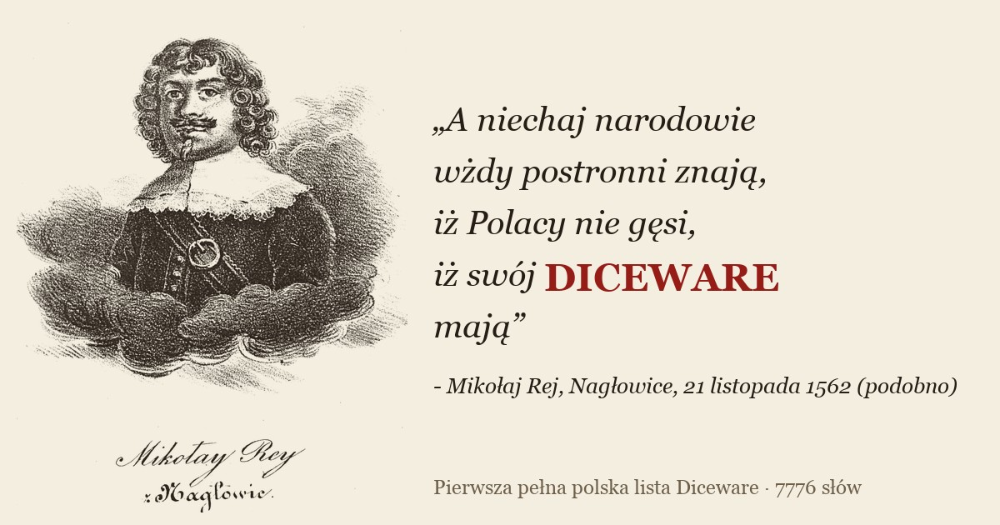

# diceware-polski

<p align="center"></p>

Pełna polska lista 7776 słów do tworzenia mocnych i łatwych do zapamiętania haseł metodą Diceware.

```text
kot szyba mleko rower las but sen
```

To tylko przykład - nie używaj go jako hasła.

## Zupełnie nie znam się na komputerach

Wejdź na **[poltrax-live.github.io/diceware-polski](https://poltrax-live.github.io/diceware-polski/)**, kliknij **Losuj** i przepisz słowa do menedżera haseł (albo na kartkę, którą schowasz w domu). Tyle.

Strona losuje w Twojej przeglądarce i niczego nigdzie nie wysyła - możesz ją nawet zapisać i otworzyć bez internetu. Wolisz w ogóle bez komputera? [Rzuć kostką](#kostką).

## Do czego takie hasło?

Do haseł, które musisz **pamiętać i wpisywać palcami**:

- hasło główne do menedżera haseł (Bitwarden, 1Password, KeePassXC…),
- poczta - bo przez nią da się przejąć wszystkie inne konta,
- konto Apple, Google albo Microsoft,
- logowanie do komputera i szyfrowanie dysku,
- domowe Wi-Fi (łatwo je podyktować gościom).

Do całej reszty (sklepy, fora, aplikacje) niech hasła losuje menedżer haseł - tych nie musisz pamiętać. I jedno hasło = jedno miejsce.

## W 30 sekund

1. Otwórz [generator w przeglądarce](https://poltrax-live.github.io/diceware-polski/) albo rzuć kostką ([instrukcja](#kostką)), albo uruchom skrypt: [Windows](#windows), [macOS](#macos), [Linux](#linux), [Python/JS/Ruby](#dla-programistów-python-javascript-ruby).
2. Weź 7 słów - nie wybieraj ich sam, niech wylosuje kostka albo komputer.
3. Zapisz wylosowane hasło w menedżerze haseł, np. Bitwarden, KeePassXC lub 1Password.

## Czym jest Diceware i czemu to działa?

Diceware to metoda wymyślona przez Arnolda Reinholda w 1995 roku. Rzucasz kostką 5 razy, zapisujesz wyniki jako liczbę od `11111` do `66666`, a potem znajdujesz przypisane do niej słowo. Powtarzasz to dla każdego słowa hasła.

Pięć rzutów daje 7776 możliwych wyników, dlatego pełna lista ma dokładnie 7776 słów.

Można o tym myśleć jak o losowaniu kul z bardzo dużej maszyny: każdy kolejny prawdziwie losowy wybór mocno zwiększa liczbę kombinacji, które musiałby sprawdzić atakujący.

Bezpieczeństwo bierze się wyłącznie z losowości i liczby słów na liście. Nie zależy od tajności listy ani języka - zakładamy, że atakujący zna całą listę.

## Która lista?

| Plik | Co zawiera i kiedy go wybrać |
| --- | --- |
| [`lists/diceware-pl.txt`](lists/diceware-pl.txt) | 7776 słów, które w ogóle nie mają polskich znaków, np. „kot” lub „szyba”. To polecana lista, bo hasło wpiszesz również na ekranie logowania przy szyfrowaniu dysku albo na obcej klawiaturze. |
| [`lists/diceware-pl-ogonki.txt`](lists/diceware-pl-ogonki.txt) | 7776 słów, także z polskimi znakami. Słowa mogą być łatwiejsze do zapamiętania, ale trzeba uważać, gdzie i na jakiej klawiaturze wpisujemy hasło. |

Oba pliki mają format znany z list EFF:

```text
11111	słowo
```

Słowa są ułożone alfabetycznie. Na liście z polskimi znakami nie ma par, które po ich usunięciu dawałyby to samo słowo, np. „laska” i „łaska” - zostaje tylko jedno.

## Ile słów?

| Liczba słów | Siła hasła | Zastosowanie |
| ---: | ---: | --- |
| 6 | około 77 bitów | Minimum |
| 7 | około 90 bitów | Polecamy do ważnych rzeczy, np. hasła głównego do menedżera haseł lub szyfrowania dysku |
| 8 | około 103 bitów | Jeszcze większy zapas |

Komputer kwantowy korzystający z algorytmu Grovera w praktyce „obcina” siłę takiego hasła o połowę. Przy 7 słowach nadal zostaje duży zapas.

## Czemu słowa, a nie „Kotek123^&*”?

Załóżmy najgorsze: ktoś wykradł bazę haseł z serwisu i ma potężny sprzęt - bilion prób na sekundę.

| Hasło | Czas złamania | Zapamiętasz? |
|---|---|---|
| `Kotek123^&*` | **ułamek sekundy** | tak |
| `SAsfbGFD$%dfG` - „wymyślone” palcami | dużo krócej, niż wygląda | nie |
| 13 naprawdę losowych znaków | ok. 700 tys. lat | nie |
| 6 losowych słów | ok. 3,5 tys. lat | tak |
| **7 losowych słów** | **ok. 27 mln lat** | **tak** |

`Kotek123^&*` spełnia wszystkie wymogi „silnego hasła”: wielka litera, cyfry, znaki specjalne, 11 znaków. Tyle że to słowo + `123` + te same klawisze z Shiftem - pierwszy schemat, który sprawdzają programy do łamania haseł.

`SAsfbGFD$%dfG` wygląda losowo, ale człowiek nie umie losować - palce chodzą po sąsiednich klawiszach (`asdf`, `gfd`, `$%`), a to też są znane wzorce. I nikt tego nie zapamięta.

Siedem słów z kostki jest i mocniejsze, i do zapamiętania.

<sub>Szacunki: połowa wszystkich kombinacji przy 10¹² prób/s. Jeśli serwis dobrze zabezpiecza hasła (np. bcrypt, Argon2), wszystkie czasy rosną tysiące razy - ale „Kotek” i tak pada w kilka tygodni.</sub>

## Jak wylosować hasło?

### Kostką

To najbardziej „paranoiczna” opcja, która nie wymaga komputera.

1. Rzuć 5 razy kostką (albo raz pięcioma kostkami i czytaj od lewej). Zapisz wyniki, np. `4 3 1 3 6`.
2. Znajdź na liście numer `43136` - obok jest słowo.
3. Powtórz tyle razy, ile słów chcesz (7 słów = 35 rzutów).

Gotowa lista do wydruku: [bez polskich znaków](https://poltrax-live.github.io/diceware-polski/lista.html) / [z polskimi znakami](https://poltrax-live.github.io/diceware-polski/lista-ogonki.html) (Ctrl+P / Cmd+P). Kartka nie ma Wi-Fi ;)

Kartkę z rzutami zniszcz, gdy zapamiętasz hasło albo przepiszesz je do menedżera.

### Windows

1. Pobierz repo (**Code → Download ZIP**) i rozpakuj.
2. Otwórz rozpakowany folder, kliknij prawym przyciskiem w puste miejsce i wybierz **Otwórz w terminalu**.
3. Wpisz:

```powershell
powershell -ExecutionPolicy Bypass -File .\haslo.ps1
```

Inne warianty:

```powershell
powershell -ExecutionPolicy Bypass -File .\haslo.ps1 -Slowa 8          # 8 słów
powershell -ExecutionPolicy Bypass -File .\haslo.ps1 -Ogonki           # lista z polskimi znakami
powershell -ExecutionPolicy Bypass -File .\haslo.ps1 -Separator "-"    # słowa rozdzielone myślnikiem
```

`-ExecutionPolicy Bypass` jest potrzebne, bo Windows domyślnie nie uruchamia skryptów pobranych z internetu. Działa tylko dla tego jednego uruchomienia, niczego w systemie nie zmienia.

### macOS

1. Pobierz repo (**Code → Download ZIP**) - rozpakuje się samo w **Pobranych**.
2. Otwórz **Terminal** (Cmd + spacja, wpisz „Terminal”).
3. Wpisz:

```bash
cd ~/Downloads/diceware-polski-main
python3 haslo.py
```

Inne warianty:

```bash
python3 haslo.py 8            # 8 słów
python3 haslo.py --ogonki     # lista z polskimi znakami
python3 haslo.py 7 -s -       # słowa rozdzielone myślnikiem
```

Jeśli Mac zapyta o zainstalowanie „narzędzi wiersza poleceń” - zgódź się, to dostarcza Pythona. Ten sam skrypt działa też na Windowsie i Linuxie, jeśli masz Pythona.

### Linux

```bash
git clone https://github.com/Poltrax-live/diceware-polski.git
cd diceware-polski
./haslo.sh              # 7 słów
./haslo.sh 8            # 8 słów
./haslo.sh 7 ogonki     # lista z polskimi znakami
```

`haslo.sh` używa `shuf` z `/dev/urandom`. Wolisz Pythona? `python3 haslo.py` działa tak samo jak na Macu.

### Dla programistów: Python, JavaScript, Ruby

```bash
pip install diceware-polski      # Python 3.9+
npm install diceware-polski      # Node.js 19+ i przeglądarki
gem install diceware-polski      # Ruby 2.7+
```

```python
import diceware_polski
diceware_polski.generate()                                        # 7 słów
diceware_polski.generate(words=8, diacritics=True, separator="-")
diceware_polski.lookup("43136")                                   # słowo dla rzutu kostką
```

```js
import { generate, lookup } from "diceware-polski";
generate({ words: 8, diacritics: true, separator: "-" });
```

```ruby
require "diceware_polski"
DicewarePolski.generate(words: 8, diacritics: true, separator: "-")
```

Każda paczka ma też komendę `diceware-polski` (np. `diceware-polski 8 --ogonki`).

Generatory korzystają z kryptograficznego generatora liczb losowych systemu, a nie ze zwykłego `random`.

## Kilka zasad

- Nie wybieraj słów samodzielnie. „Losowo” w głowie nie jest losowo.
- Nie losuj ponownie tylko dlatego, że wypadło słowo, które Ci się nie podoba. Takie poprawianie wyniku trochę osłabia hasło.
- Nie zmieniaj wylosowanych słów.
- Nie generuj ważnych haseł na nieznanych stronach internetowych. [Nasza strona](https://poltrax-live.github.io/diceware-polski/) losuje w przeglądarce, nic nie wysyła i ma jawny kod (`docs/index.html`).
- Nie proś chatbota AI o wygenerowanie hasła. Hasło może wtedy trafić do cudzych logów.
- Separator możesz wybrać dowolnie, np. spację albo myślnik.
- Możesz dopisać cyfrę, jeśli serwis tego wymaga.
- Gotowe hasło zapisz w menedżerze haseł, np. Bitwarden, KeePassXC lub 1Password.

Bitwarden ma własny generator haseł ze słów, ale działa on tylko po angielsku i nie pozwala podpiąć własnej listy. Możesz więc wylosować polskie hasło tutaj, a potem ręcznie zapisać je w Bitwardenie.

## Dlaczego zrobiliśmy nową listę?

Projekt [MaciekTalaska/diceware-pl](https://github.com/MaciekTalaska/diceware-pl) ma 3888 słów, czyli połowę pełnej listy Diceware.

Ta lista działa, ale każde wylosowane słowo daje około 11,9 bitu siły zamiast około 12,9 bitu. Żeby uzyskać podobny poziom bezpieczeństwa, trzeba więc użyć większej liczby słów.

Projekt Maćka był dla nas inspiracją i należy mu się za to duże dzięki. Z tej samej listy korzysta [diceware.io](https://diceware.io).

Jest jeszcze starsza polska lista z pełnymi 7776 pozycjami (np. na [diceware.net](https://www.diceware.net/?dicelist=polish)), ale sporo w niej cyfr, symboli i strzępków typu `:-(`, `io`, `1975` - trudno z niej zapamiętać hasło.

My chcieliśmy pełne 7776 pozycji z samych normalnych słów.

## Jak powstała lista?

1. **Słowa**  
   Wzięliśmy formy podstawowe z otwartego słownika [SJP.pl](https://sjp.pl), dostępnego m.in. na licencji CC BY 4.0.

2. **Kolejność**  
   Uszeregowaliśmy słowa według częstości występowania w napisach filmowych [OpenSubtitles 2018](https://opus.nlpl.eu/OpenSubtitles2018.php), korzystając z projektu [FrequencyWords](https://github.com/hermitdave/FrequencyWords) Hermita Dave'a na licencji CC BY-SA 4.0. Dzięki temu wyżej trafiały słowa, których ludzie naprawdę używają.

3. **Sito**  
   Zostawiliśmy słowa mające od 3 do 9 liter. Odfiltrowaliśmy imiona, nazwy, marki, skróty, wulgaryzmy, słowa ponure związane m.in. ze śmiercią, przemocą i chorobami, a także słowa obce, rzadkie, specjalistyczne oraz takie z pułapką ortograficzną, np. „morze” i „może”. Ocenę słów wspomagały modele AI Claude, a potem zrobiliśmy osobną kontrolę słów nieprzyzwoitych i dodaliśmy ręczną czarną listę w [`data/blocklist.txt`](data/blocklist.txt).

4. **Pilnowanie listy**  
   Skrypty sprawdzają, czy każde słowo jest unikalne i czy lista ma dokładnie 7776 pozycji. Na liście z ogonkami pilnujemy też, żeby po usunięciu polskich znaków dwa słowa nie dawały tego samego wyniku. Wszystkie skrypty użyte do budowania list są w katalogu [`scripts/`](scripts/).

## Poprawki i zgłoszenia

Jeśli znajdziesz słowo dziwne, obraźliwe albo trudne do napisania, załóż [Issue](../../issues) lub wyślij Pull Request.

Każda zmiana słowa zmienia również numerację całej listy, dlatego kolejne wersje list tagujemy. Dzięki temu można wrócić do dokładnie tej wersji, której używał konkretny generator.

## Licencja i podziękowania

- Listy słów: [CC BY-SA 4.0](LICENSE-LISTS), ponieważ źródło danych o częstości słów również korzysta z CC BY-SA 4.0.
- Kod i skrypty: [MIT](LICENSE).

Dzięki dla:

- Mikołaja Reja za inspirację (portret: litografia ok. 1850, [Wikimedia Commons](https://commons.wikimedia.org/wiki/File:Miko%C5%82aj_Rey_z_Nag%C5%82owic.jpg), domena publiczna; oryginał cytatu: „…iż swój język mają”, *Do tego co czytał*, 1562),

- [SJP.pl](https://sjp.pl) za otwarty słownik,
- [Hermita Dave'a i projektu FrequencyWords](https://github.com/hermitdave/FrequencyWords) za dane o częstości słów,
- [OpenSubtitles i OPUS](https://opus.nlpl.eu/OpenSubtitles2018.php) za korpus napisów,
- [Arnolda Reinholda](https://world.std.com/~reinhold/diceware.html) za metodę Diceware,
- [EFF](https://www.eff.org/dice) za listy i dobry opis metody,
- [Maćka Talaski](https://github.com/MaciekTalaska/diceware-pl) za wcześniejszą polską listę i inspirację.

## English summary

Web generator: https://poltrax-live.github.io/diceware-polski/ (runs locally in the browser, no network requests). Printable lists: `docs/lista.html`, `docs/lista-ogonki.html`.


`diceware-polski` provides two complete Polish Diceware word lists with exactly 7,776 entries each.  
The recommended list contains only words without Polish characters, while the second list also includes words with Polish diacritics.  
Seven randomly selected words provide about 90 bits of entropy and are recommended for important passwords.  
Passwords can be generated with physical dice or the included scripts for Windows, macOS, Linux, and as packages for Python (`pip install diceware-polski`), JavaScript (`npm install diceware-polski`) and Ruby (`gem install diceware-polski`).  
The generators use the operating system's cryptographically secure random number generator.  
The word lists are licensed under CC BY-SA 4.0, while the scripts are available under the MIT license.  
Please do not generate important passwords on websites or ask an AI chatbot to create them.

Zrobiliśmy to w [Poltrax](https://poltrax.live), gdzie na co dzień śledzimy GPS-em zawodników na trasach biegów i rajdów rowerowych - tym razem kropki zamieniliśmy na słowa.

Autorzy: Michał Piórkowski i [Claude.ai](https://claude.ai).
